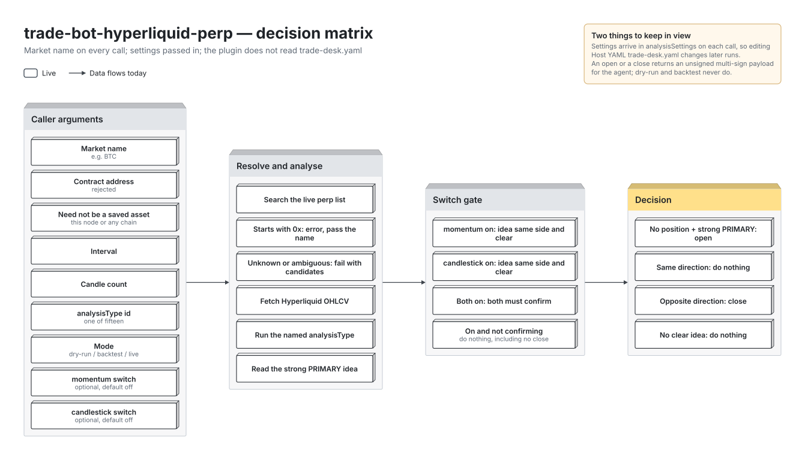

# trade-bot-hyperliquid-perp

Decides a Hyperliquid perpetual from a market name, a candle window, and one technical-analysis type from the market-data library.

The argument is a Hyperliquid market name such as `BTC`. A contract address is rejected. The name does not have to be saved on the node. Periods, entry settings, key-level touch settings, Fibonacci bracket settings, the candlestick hit gate, and classic-pattern scan settings are passed in from Host YAML `trade-desk.yaml` (`universal`, `keyLevels`, `keyLevelFibonacci`, `candlestick.minConfidenceCandles`, and `classicPatterns`). `minConfidenceCandles` defaults to 0.8 when that line is absent. It is used for `candlestick_patterns` and for the `candlestick` switch on every other analysis type. Position size comes from the `percent` argument. The `momentum` and `candlestick` switches require that confirmation on the same side only before an open. A close does not use either switch. Dry-run and backtest do not use real USDC. The tool returns an unsigned payload. It does not sign and it does not post the multi-sign request.

Analysis types: `trend_structure`, `elliott_waves`, `key_levels`, `key_level_fibonacci`, `divergence`, `range_volatility`, `bollinger_bands`, `donchian_breakout`, `supertrend`, `ichimoku`, `z_score`, `moving_averages`, `chart_patterns`, `momentum`, `candlestick_patterns`.

Intervals: `1m`, `3m`, `5m`, `15m`, `30m`, `1h`, `2h`, `4h`, `8h`, `12h`, `1d`, `3d`, `1w`, `1M`.

## Example

From the node chat:

```text
/trade-bot-hyperliquid-perp BTC 4h 400 chart_patterns backtest
```

That paper-trades BTC on 400 candles of 4h chart patterns. Leave `backtest` off for a dry-run. `live` returns an unsigned open or close when the idea calls for one. Add `momentum` or `candlestick` to require that confirmation before an open. A number such as `50` is the percent of tradable notional, and the default is 50.

Candlestick analysis runs inside the plugin, including the `candlestick_patterns` type and the `candlestick` switch. The decision tool does not call `analyze_candlestick_patterns` and does not draw the interactive candlestick menu. A separate request for a chart still uses that menu.



Version **v1.1.0**.
